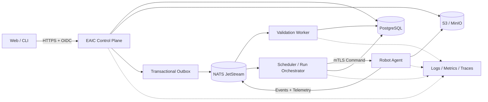

# EAIC 架构基线

## 1. 为什么先做模块化单体

第一年采用“模块化单体 Control Plane + 独立 Worker + Robot Agent”，不是一开始拆十几个
微服务。这样仍然能练到真实的进程边界、消息、网络和故障恢复，同时减少部署噪音。
模块必须通过明确接口通信，未来只有在团队归属、负载或可靠性需求确实不同的时候才拆服务。

建议技术栈：

- Python 3.12 + FastAPI：Control Plane 和 Worker；
- PostgreSQL：业务事实、状态和 Ledger；
- S3/MinIO：Submission、Result、日志和视频对象；
- PostgreSQL Outbox + NATS JetStream：可靠发布与异步事件；
- Redis：可丢弃缓存、限流和短租约，不保存唯一事实；
- OpenTelemetry + Prometheus/Grafana + Loki + Tempo：Logs/Metrics/Traces；
- Docker Compose：本地环境；GitHub Actions：CI/CD；Terraform：云资源。

这些是基线，不是信仰。改变技术选择时写 ADR，并说明约束、替代方案和迁移成本。

## 2. 运行时组件



## 3. 主链职责和失败语义

| 对象 | Owner | 输入 → 输出 | 权威存储 | 重试/去重 | 失败恢复与审计 |
|---|---|---|---|---|---|
| Project | Control Plane | 租户、配置 → project_id | PostgreSQL | 创建命令幂等键 | 审计 actor 与配置版本 |
| Submission | Submission 模块 | 文件、摘要 → immutable artifact | PostgreSQL + S3 | 内容哈希 + 幂等键 | 未完成上传过期清理；保留对象版本 |
| Validation | Validation Worker | submission_id → report | PostgreSQL + S3 | `(submission_id, validator_version)` 唯一 | 租约超时重领；失败进入 DLQ |
| Reservation | Scheduler | 合格需求 → robot/time slot | PostgreSQL | 资源唯一约束 + 乐观锁 | 租约过期释放；记录竞争决策 |
| Deployment | Run Orchestrator | artifact + robot → deployment | PostgreSQL + Robot | command_id 去重 | Robot 回报已应用版本；可回滚 |
| Run | Robot Agent/Orchestrator | deployment → execution | PostgreSQL + Edge WAL | run_id 单次状态转换 | 断网本地继续；恢复后按序补传 |
| Result | Result 模块 | telemetry/artifacts → manifest | PostgreSQL + S3 | 对象哈希 + 分片序号 | Multipart 恢复；manifest 验证 |
| Billing | Billing 模块 | billable event → ledger entries | PostgreSQL Ledger | event_id 唯一 | 只追加冲正，不覆盖原账；双向关联 run_id |

## 4. 状态机

只有 Command 请求改变状态；Event 描述已经发生的事实。

```text
Submission: CREATED → UPLOADING → SUBMITTED → VALIDATING
                               → VALIDATED | REJECTED

Reservation: REQUESTED → HELD → CONFIRMED → RELEASED | EXPIRED | FAILED

Run: QUEUED → DEPLOYING → READY → RUNNING
                     → SUCCEEDED | FAILED | CANCELLED | LOST

Billing: PENDING → POSTED → ADJUSTED
```

规则：

- 状态只能沿显式边迁移；数据库用 compare-and-set 防并发覆盖。
- 终态仍可产生补偿命令，例如成功 Run 的错误费用用冲正分录处理。
- Event 包含 `event_id`、`event_type`、`schema_version`、`occurred_at`、
  `aggregate_id`、`tenant_id`、`trace_id` 和 `causation_id`。
- 消费者先登记 `event_id`，再产生业务效果；重复事件直接返回已有结果。

## 5. 一次请求怎样走完整系统

1. 客户端通过 DNS/TLS 到 API，OIDC Token 被验证并映射成 tenant/user。
2. API 校验权限，在一个 PostgreSQL 事务中写业务行和 Outbox 行。
3. Outbox Publisher 把 Event 发送到持久化消息系统；发送失败可继续扫描重试。
4. Worker 领取消息并加租约，执行业务；超时后其他 Worker 可重新领取。
5. 大文件不穿过消息队列，只传 S3 URI、哈希和元数据。
6. Worker 写结果与下一条 Outbox Event，然后 ACK；崩溃导致重复处理但不重复效果。
7. API 从权威数据库读取状态；Redis 命中时加速，失效时回源。
8. 所有步骤传播 `trace_id`；审计表记录谁、何时、为何改变了什么。

## 6. Cloud 与 Edge 安全边界

必须在机器人本地完成：

- 急停、速度/力/工作空间限制、碰撞保护；
- 高频闭环控制和确定性时序；
- 断网时进入已批准的安全状态；
- 验证命令签名、版本和允许的动作范围。

可以在云端完成：

- 项目与 Submission 管理、Validation、资源调度；
- 低频任务编排、Fleet 视图、历史分析和 Billing；
- 模型训练、批量数据处理和非实时优化。

LLM 不得独立决定：

- 绕过 Safety Controller；
- 扩大机器人运动边界或解除急停；
- 未经策略验证执行任意用户代码；
- 在缺少可验证状态时宣称物理动作成功。

## 7. 可靠性目标的起点

早期建议目标（需要在真实数据后修订）：

- Control Plane 月可用性 SLO：99.9%；
- 已接受 Submission 不丢失：RPO 0（数据库提交后）；
- Control Plane 恢复：RTO 60 分钟；
- 异步 Validation 99% 在 5 分钟内开始；
- Billing 重复分录：0；每一分费用可追溯到 Run 和原始 Event。

每个 SLO 必须绑定指标、窗口、错误预算、告警和 Runbook，不能只写百分比。

